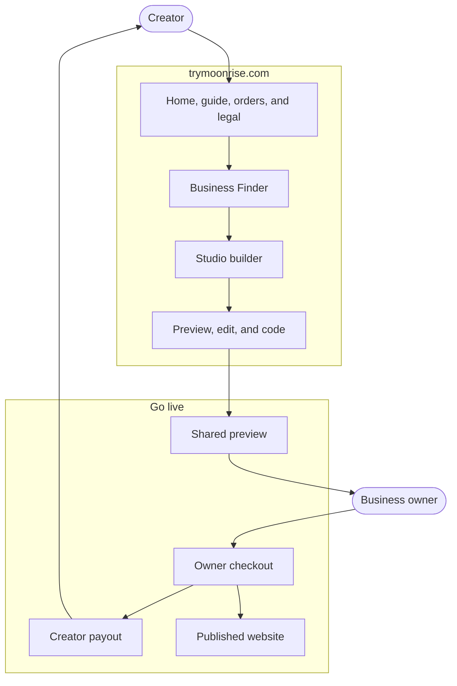

  

<h1 align="center">Moonrise Studio</h1>

  Discover local businesses in your area, build websites with one click, share live previews, and earn money when those websites go live commercially.

  <a href="https://trymoonrise.com">trymoonrise.com</a>

Moonrise is a hosted studio for people who sell websites to nearby businesses. A creator finds a shop, clinic, or cafe, builds the site in Studio, and sends a live preview. The owner pays when that site goes live. The creator keeps 90%.

Use Moonrise at [trymoonrise.com](https://trymoonrise.com). This repository explains the product. It is not a download, and it is not a project to install or host yourself.

## How it works

1. **Find.** Business Finder lists nearby businesses and shows which ones still need a site.
2. **Build.** One action turns that business into a page. The creator can preview it, edit the words, or look at the code.
3. **Share.** The owner gets a live preview. The preview stays marked until they decide to go live.
4. **Get paid.** The owner pays to publish. Moonrise pays the creator their share.
5. **Go live.** The business has its own site, and the order is no longer a preview.

## The platform

### Public site

Anyone can open [trymoonrise.com](https://trymoonrise.com). The home page explains the offer. Sign-in starts a studio. The guide, orders page, and legal pages stay available without an account: help, a way to find an order, privacy, terms, refunds, and a way to report a problem.

### Studio

After sign-in, the workspace is one place:

| Part | What it does |
|---|---|
| Dashboard | Shows progress, sales, and recent projects |
| Business Finder | Searches the area and keeps the businesses worth a site |
| Builder | Creates a site from the business in one step |
| Editor | Switches among preview, edit, and code, and turns features on or off |
| Clients | Keeps the businesses that have paid |
| Settings | Holds the account, payout details, and studio preferences |

The editor is the same surface the creator uses to present the work. A contact form, a domain, and the other pieces of the page can be turned on, and the preview changes with them.

### Preview, payment, and the live site

The preview is a real page the owner can open. It is watermarked so the work can be shared before anyone pays. Checkout is the moment the site becomes a commercial website. Moonrise takes the payment, pays the creator 90%, and publishes the site for the business.

Orders can be looked up from the public orders page. Account, billing, and payout questions stay inside Studio.

## Who it is for

Creators and freelancers who want a clear path from a nearby business to a paid website. The business owner only needs the preview and the checkout. They do not need a studio account to say yes.

## Policies

- [Support](SUPPORT.md)
- [Accessibility](ACCESSIBILITY.md)
- [Security](SECURITY.md)
- [Contributing](CONTRIBUTING.md)
- [Governance](GOVERNANCE.md)
- [Code of conduct](.github/CODE_OF_CONDUCT.md)
- [License](LICENSE)
- [Terms of Service](https://trymoonrise.com/terms)
- [Privacy Policy](https://trymoonrise.com/privacy)

Questions: [trymoonrise@gmail.com](mailto:trymoonrise@gmail.com) or [(401) 300-0957](tel:+14013000957).
